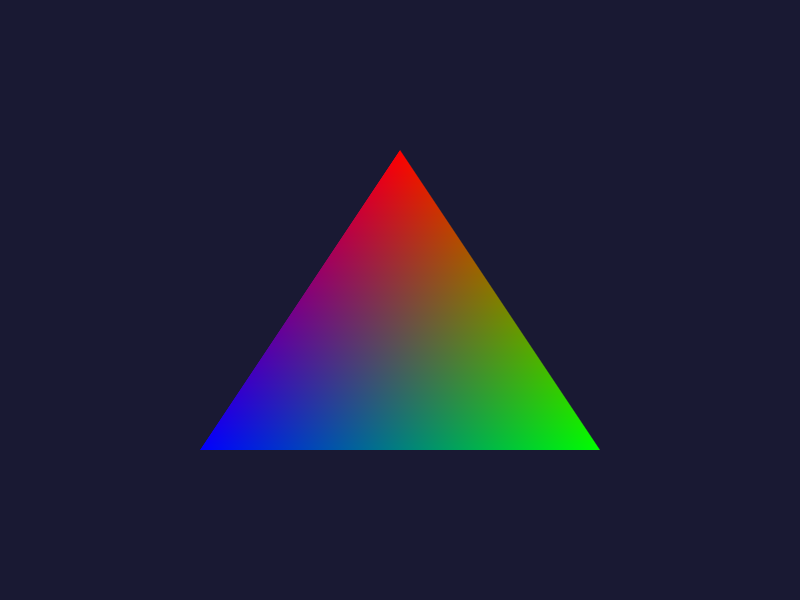
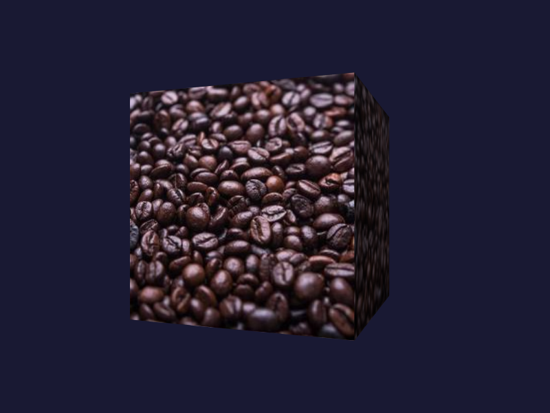

# C# Examples

### [Hello Triangle](HelloTriangle)

Introductory to LLGL.NET that renders the classic gradient triangle.

### [Texturing](Texturing)

Renders a textured cube whose image is loaded from a URL at launch.

