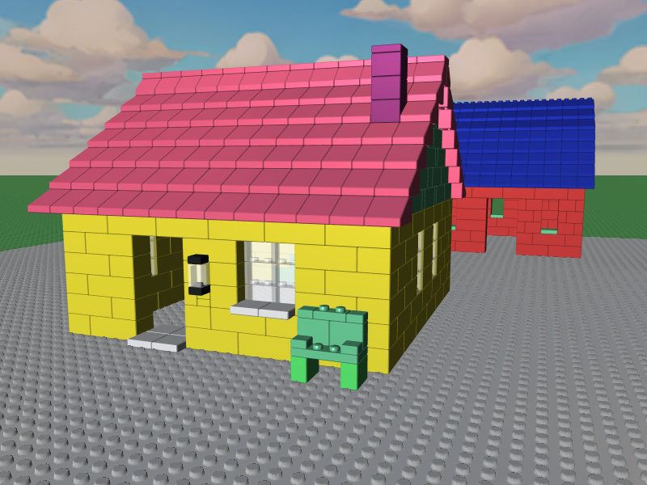

# BrickPlay - Tutorial to a small 3D toy with LLGL

## Overview

- [Instanced Rendering](#instanced-rendering)
  - [Instance Groups](#instance-groups)
  - [kd-Tree Construction](#kd-tree-construction)
  - [Ray-Casting](#ray-casting)
  - [Collision Detection](#collision-detection)
- [Weighted-Blended Order Independent Transparency](#weighted-blended-order-independent-transparency)
- [An Infinite Plane](#an-infinite-plane)
  - [Parallax Occlusion Mapping](#parallax-occlusion-mapping)
- [Skybox](#skybox)
- [Silhouette Rendering](#silhouette-rendering)
- [Save The World](#save-the-world)
- [User Interface](#user-interface)
  - [Batched Draw Calls](#batched-draw-calls)
  - [Platform Differences](#platform-differences)
- [Camera Controls](#camera-controls)
- [Caveats](#caveats)
- [Extensibility](#extensibility)

## Instanced Rendering

*Mention vertex input layout, use of multiple vertex buffers, and organization of `vertexAndPreviewInstanceBuffer` GPU buffer etc.*

### Instance Groups

*Outline the algorithm for the instance GPU buffer, its capacity handling (similar to `std::vector`),*
*the group transfers for optimized rendering, and its format with minimal size of just 8 bytes per instance*

### kd-Tree Construction

*Mention cells for brick placement and blocking neighbors*

### Ray-Casting

*Ray/AABB intersection tests for scene picking*

### Collision Detection

*Mention testing against AABB faces first and edges/corners second*

## Weighted-Blended Order Independent Transparency

References:
- https://learnopengl.com/Guest-Articles/2020/OIT/Weighted-Blended

## An Infinite Plane

*Mention vertex generation for infinite plane*

References:
- https://github.com/blitz-research/blitz3d

### Parallax Occlusion Mapping

*Mention benefit of using Parallax Mapping instead of tessellation for studs on the plane*

References:
- https://learnopengl.com/Advanced-Lighting/Parallax-Mapping

## Skybox

*Briefly mention use of `CopyTexture()` to 'bake' cube faces into a single cube texture*
*Also mention use of skybox in Blinn-Phong shading*

## Silhouette Rendering

*Mention use of geometry shader in D3D and use of stencil buffer*

## Save The World

*Briefly outline the file format that serves its purpose while being simplistic*

## User Interface

### Batched Draw Calls

*Mention why this is invaluable for dynamic geometry like UI elements*

### Platform Differences

*Mention layout for desktop vs. mobile controls, Android quirks with static fields that are not destructed because the project's .so file remains in memory*

## Camera Controls

*Mention the minimalistic physics integration for smooth camera movement*

## Caveats

*Mention issues I ran into while porting this to the web and mobile. Maybe also mention that I ran into a driver bug while working on this.*

## Extensibility

*Mention how Python scripts and other external tools can be utilized to expand the experience, like with a script to generate scene files from an image*

