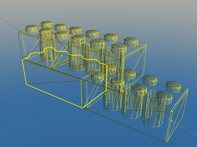
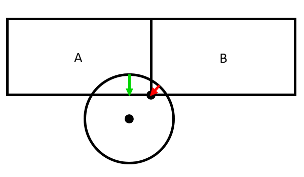
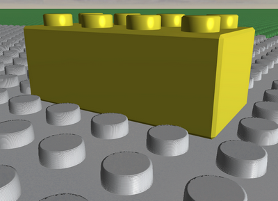
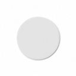
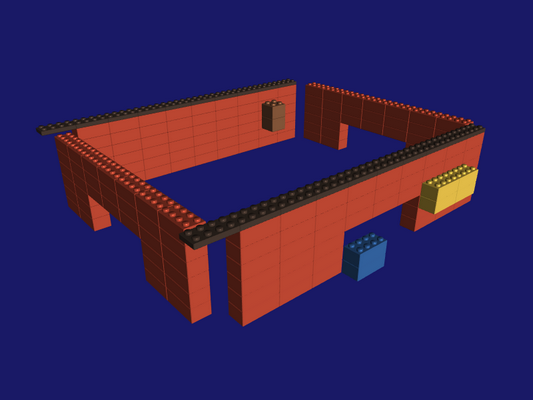
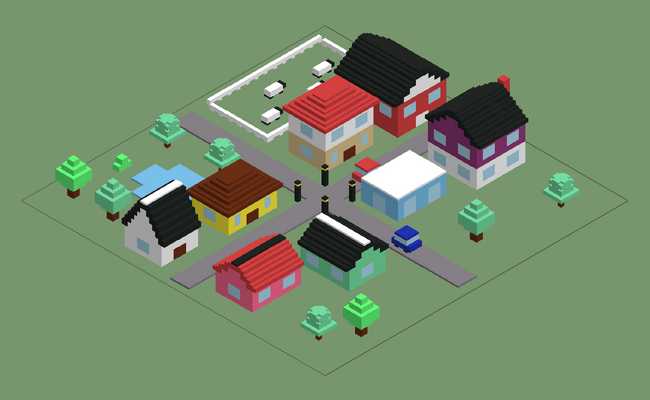
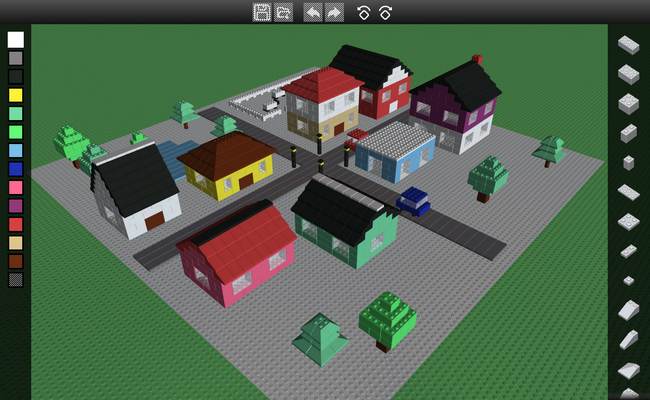

# BrickPlay - Tutorial to a small 3D toy with LLGL

<p align="center"></p>

## Introduction

*Last edited on Oct. 21, 2026 by L.Hermanns*

This project and tutorial is meant to provide a comprehensive example of how to build a small yet complete game (or toy) with LLGL.
While LLGL serves first and foremost as an abstraction layer to communicate with graphics hardware in a platform agnostic manner,
it also contains a few utilities to make working with the OS windowing system easier.
Most projects will likely use either a custom solution or other third party libraries like GLFW, wxWidgets, or SDL, but in this example,
we make use of the Window and Canvas event listeners to handle user input on both desktop and mobile devices as well as the web.
In fact, this example is highly catered towards the browser environment as it features some JavaScript code to take advantage of certain
web based features such as storing the user generated content in the browser's cache and offering them to share it with a private PostgreSQL database.

In this tutorial we'll go into depth of various features to outline how to accomplish certain rendering techniques in LLGL,
challenges I faced while developing it, and how in the era of AI working with LLMs helped me accelerate my productivity in some areas.
And if you want to convince yourself that this project was not AI-slopped, please feel free to search the commit history for "BrickPlay".

Please note that this tutorial expects you to be familiar with the basics of LLGL,
so it's highly recommended to start with the [HelloTriangle](../HelloTriangle/README.md) tutorial before proceeding.
Also note that code excerpts in this tutorial are often pseudocode or don't reflect the actual implementation 1:1.
They are only intended to convey the concept.


## Overview

- [Instanced Rendering](#instanced-rendering)
  - [Instance Groups](#instance-groups)
  - [kd-Tree Construction](#kd-tree-construction)
  - [Ray-Casting](#ray-casting)
  - [Collision Detection](#collision-detection)
- [Weighted-Blended Order Independent Transparency](#weighted-blended-order-independent-transparency)
- [An Infinite Plane](#an-infinite-plane)
  - [Parallax Occlusion Mapping](#parallax-occlusion-mapping)
- [Skybox](#skybox)
- [Silhouette Rendering](#silhouette-rendering)
- [User Interface](#user-interface)
  - [Batched Draw Calls](#batched-draw-calls)
  - [Platform Differences](#platform-differences)
- [Camera Controls](#camera-controls)
- [Extensibility](#extensibility)
- [Appendix: In the Age of AI](#appendix-in-the-age-of-ai)


## Instanced Rendering

This project was born out of the idea to have a nicer looking "Instancing" example and it was initially called "InstancingAdvanced".
Once the project became a bit of a showcase compared to all the examples in this repository, it was renamed to "BrickPlay".

Storing the instance data for all bricks is split into two vertex buffers:
1. `vertexAndPreviewInstanceBuffer` stores the vertices of all brick shapes.
   At the end, it also stores the instance data for the preview brick that is rendered separately when the user moves bricks around.
   `previewInstanceBufferOffset` stores the byte offset to that instance data.
   This simplifies managing the preview brick data from the instance groups described below.

2. `BrickScene::instanceBuffer` stores the instance data for all bricks.
   This is organized via 'instance groups' so that bricks can be rendered in optimized ways, for example bricks that are completely covered top and bottom
   can be rendered with a simplified mesh that is open at the top and bottom (see <a href="#figure-wallsonly">Figure 1</a>), omitting the larger amount of vertices that visualize the studs.
   Bricks that are covered entirely and won't be visible to the user don't have to be rendered at all.
   While `BrickScene` holds the GPU vertex buffer for instances, the `BrickDictionary` class uses the [singleton design pattern](https://www.geeksforgeeks.org/system-design/singleton-design-pattern/)
   to store the CPU data of vertices and holds the instance groups data, like how many instances are in each group,
   how much capacity until the GPU instance buffer has to be resized (similarly to how C++'s `std::vector::resize` works in most STL implementations),
   and the index to the first instance for each group in the global instance buffer.

<figure id="figure-wallsonly">
  <p align="center">
    
    <figcaption>Figure 1: Covered bricks only render their walls, highlighted with a silhouette.</figcaption>
  </p>
</figure>

The singleton `BrickDictionary` allows for project-wide lookup of information about each brick (hence "dictionary"),
which is loaded from [BrickPlay.config.txt](BrickPlay.config.txt) via a custom text-based file format similar to Wavefront Object files (more about that in [AGENTS.md](AGENTS.md)).

Since bricks are only rendered with a solid color and no texturing, the vertex structure only needs a 3D coordinate and a normal vector for basic lighting.
The instance structure is organized in a compact 8 bytes layout: 16-bit signed integer for X/Y/Z coordinates that place the bricks within the grid which is then scaled in the vertex shader,
8-bit integer to encode the rotation (0-3) which is multiplied by 90 degrees in the shader, and another 8-bit to encode the index for the color palette.
Since the user can only pick from a small set of colors and the app doesn't provide a full color wheel, we don't have to encode full RGB per instance.
All instance attributes are encoded into a single `Format::RGBA16SInt` vertex attribute, so rotation and color index need to be unpacked in the shader.
This is what the vertex attribute declaration looks like:
```cpp
const LLGL::VertexAttribute vertexAttribs[] = {
    // Per-vertex attributes (locations 0 and 1, binding slot 0)
    LLGL::VertexAttribute{
        "position", LLGL::Format::RGB32Float, 0, offsetof(BrickVertex, position), sizeof(BrickVertex), /*slot:*/ 0
    },
    LLGL::VertexAttribute{
        "normal",   LLGL::Format::RGB32Float, 1, offsetof(BrickVertex, normal  ), sizeof(BrickVertex), /*slot:*/ 0
    },

    // Per-instance attributes (location 2, binding slot 1, instance divisor 1)
    LLGL::VertexAttribute{
        "packedInstance", LLGL::Format::RGBA16SInt, 2, 0, sizeof(Instance), /*slot:*/ 1, /*instanceDivisor:*/ 1
    },
};
```
While the instanced bricks are limited to discrete grid coordinates, the preview brick doesn't use the instance 3D coordinates and instead is transformed with a full 4x4 matrix to realize intricate animation.
This, alongside other information such as view-projection matrix, is all stored in a single (~500 bytes) constant buffer called "SceneView".

The instance group information can be passed directly into the `DrawInstanced()` commands (see `RenderBrickInstanceGroup()` in *BrickPlay.cpp*).
If the rendering API does not support *offset instancing* (like OpenGL 4.1 or older), we can use the byte offset in `SetVertexBuffers()` to point the drawing commands to the first instance:
```cpp
void RenderBrickInstanceGroup(BrickMesh mesh, InstanceGroup group, LLGL::VertexBufferView vertexBufferViews[2]) {
    if (hasOffsetInstancing) {
        // Draw all group instances with instance offset (firstInstance)
        commands->DrawInstanced(mesh.numVertices, mesh.firstVertex, group.numInstances, group.firstInstance);
    } else {
        // Bind vertex buffers with instance offset if not natively supported
        vertexBufferViews[1].offset = group.firstInstance * sizeof(Instance);
        commands->SetVertexBuffers(2, vertexBufferViews);
        commands->DrawInstanced(mesh.numVertices, mesh.firstVertex, group.numInstances);
    }
}
```


### Instance Groups

To render a large number of bricks with different shapes is composed of two concepts encoded into a single number described as a 'group ID':
1. The first component to this is a unique ID for each brick shape (referred to as `brickId` or 'brick type')
   and these are defined by the order in which they are loaded from the *BrickPlay.config.txt* file.
   Since the scene file format uses their label (e.g. '1x3_roof') and not this index,
   changing their order won't affect scene files and ensures compatibility regardless of those changes.
2. The second component is the group type (encoded via the `BrickGroup` enum).
   Bricks are transferred between those groups depending on how they should be rendered or whether they need to be rendered at all:
   ```cpp
   enum BrickGroup {
       BrickGroup_Default,     // Default opaque brick rendering
       BrickGroup_WallsOnly,   // Bricks rendered with an optimized version, when blocked from above and below
       BrickGroup_Transparent, // Render bricks with different shaders to achieve order-independent-transparency (OIT)
       BrickGroup_Invisible,   // Not rendered at all, for bricks that are blocked from all sides
   };
   ```

The group ID is then encoded by merging these two numbers into a single 32-bit unsigned integer. This can be achieved either by bit-shifting or simple arithmetic.

With the group ID, we can pick the instance group from an array with the information we need to store our brick instances:
```cpp
struct InstanceGroup {
    // Number of instances to render for this group
    uint32_t numInstances;

    // Zero-based index to the first instance into the global `instances` container for this group.
    uint32_t firstInstance;

    // Number of instances allocated for this group in the global `instances` container.
    uint32_t instanceCapacity;
};
```
The algorithm for allocating instances and reduce the number of times the GPU buffer has to be re-created as it grows is implemented in `AllocateInstancesInGroup()`:
```cpp
Instance* AllocateInstancesInGroup(uint32_t groupId, uint32_t count) {
    InstanceGroup& group = GetInstanceGroupById(groupId);
    uint32_t instanceOffset = group.firstInstance + group.numInstances;

    // Check if GPU buffer needs to be resized.
    // Otherwise, the capacity of this groups is still sufficient to hold `count` new instances
    if (group.numInstances + count > group.instanceCapacity)
    {
        // Grow the capacity for this group by 150%.
        // This grow strategy is similar to how std::vector::resize() works.
        uint32_t numMinCount = group.numInstances + count;
        uint32_t numCapacity = numMinCount + numMinCount/2;

        // Insert new instances into global container
        uint32_t instanceGrowth = numCapacity - group.instanceCapacity;
        instances.insert(instances.begin() + instanceOffset, instanceGrowth, Instance{});

        // Resize GPU buffer and mark all instances as dirty if the buffer was re-created.
        // `ResizeInstanceBuffer()` also keeps track of the size (in bytes) of the buffer.
        // If the GPU buffer is large enough, it doesn't have to be re-created
        // and we only mark instances as dirty from the current offset to the end.
        if (ResizeInstanceBuffer(instances.size() * sizeof(Instance)))
            MarkInstanceDirty(0, instances.size());
        else
            MarkInstanceDirty(instanceOffset, instances.size() - instanceOffset);

        // All instance groups that are stored after the current one need their instance offsets updated
        for (uint32_t nextGroupId = groupId + 1;
             nextGroupId < BrickDictionary::Get().NumBrickTypes() * BrickGroup_Num;
             ++nextGroupId)
        {
            GetInstanceGroupById(nextGroupId).firstInstance += instanceGrowth;
        }

        // Store new instance capacity for this group
        group.instanceCapacity = numCapacity;
    }

    // Return pointer to first new instance
    Instance* firstInstancePtr = &(instances[instanceOffset]);
    MarkInstanceDirty(instanceOffset, count);
    group.numInstances += count;

    return firstInstancePtr;
}
```
If the instance buffer has to be resized, `ResizeInstanceBuffer()` deletes the old buffer and creates a new one:
```cpp
LLGL::BufferDescriptor instBufferDesc {
  .size      = newSize,
  .stride    = sizeof(Instance),
  .bindFlags = LLGL::BindFlags::VertexBuffer,
}
instanceBuffer = renderSystem.CreateBuffer(instBufferDesc);
```


### kd-Tree Construction

Now that we can create brick instances for rendering, we have to find a way to place them into the scene
and ensure users can't accidentally place bricks into each other like in the Backrooms :-)

Since these bricks move in a grid and have discrete dimensions in which they can be plugged together, some tree hierarchy is a logical choice.
An [Octree](https://en.wikipedia.org/wiki/Octree) could potentially be used for this, but there's the well-known problem of the "teapot in a stadium"
(there's an [article about this here](https://geometrian.com/resources/tutorials/rtaccel/), alongside an overview of several tree structures to address this).
I ultimately settled for the [kd-Tree](https://en.wikipedia.org/wiki/K-d_tree), which is essentially binary space partitioning (BSP)
with the restriction of axis-aligned planes that partition the space.
This is ideal to reduce tree nodes for unoccupied space and the restriction of axis-aligned planes is perfect for this project since all bricks are already axis aligned by nature.

Each leaf in this tree structure stores only a reference to the brick instances.
This is implemented via the `Brick` structure that stores the group ID and the index within that group that points to its brick instance all in just 4 bytes.
Since we're storing an index and not a pointer, resizing the global `instances` buffer does not invalidate those indices whereas any pointer that points to those entries would get invalidated.

The tree hierarchy is being used by the `BrickScene` class for the following purposes:
1. Store where bricks are being placed to detect whether a cell is already occupied.
2. Check whether bricks are visually being blocked by other bricks, either entirely around them (to detect whether they don't have to be rendered at all),
   or above and below them, in which case they can be rendered with a simplified 3D model that only renders its walls.
3. Ray-casting so that the user can pick up a brick by pointing at it.
4. Collision detection and resolution so that the user can't steer the camera through the bricks to give the illusion of solid bricks.


### Ray-Casting

We use simple ray-casting (not to be confused with GPU accelerated ray-tracing like RTX) to let the user pickup a brick and place it back into the scene.
As the name implies, we need a ray representation (3D origin and 3D direction vector) that is generated from a 2D screen coordinate where the user points at - via touch input on mobile or the cursor on desktop.

For this calculation we need the viewport size, the projection matrix, and the view matrix without its position (stored in `vMatrixNoPosition`).
The view position is only needed for the ray origin but the ray direction is calculated by converting the 2D screen coordinate into normalized-device-coordinates (NDC space)
and then transforming it with the inverse of projection and that special edition view matrix. That gives us a pixel perfect ray that points exactly into the scene where we need it.

That function looks somewhat like this (simplified):
```cpp
Ray ProjectScreenPosToViewRay(LLGL::Offset2D screenPos) const {
    LLGL::Viewport viewport{ swapChain->GetResolution() };

    // Negate Y-axis. 2D origin is top-left corner of screen. In 3D, +Y axis goes up.
    Vector4 ndc{
          (screenPos.x - viewport.x) / viewport.width  * 2.0 - 1.0,
        -((screenPos.y - viewport.y) / viewport.height * 2.0 - 1.0),
        1.0,
        1.0,
    };

    Vector3 rayOrigin = camera.position;
    Vector3 rayDirection = Inverse(projection * camera.vMatrixNoPosition) * ndc;

    return Ray{ rayOrigin, Normalize(rayDirection) };
}
```

With the ray constructed, we can start traversing our tree hierarchy. Our kd-Tree splits the space into two separate sections.
The naive approach is to simply split each section in half along X, Y, or Z axis, but this leads to some pretty poor utilization of large empty space.
This project doesn't use a vancy heuristic, it simply splits the space at whatever position along the largest dimension a new brick is placed.
Not optimal but considering that users likely place bricks within the same vicinity, this reduces the amount of nodes we have to create for our tree representation.

Each tree node consists of these fields:
- **Axis** for the logical plane that separates a node into two sub nodes (referred to as 'children').
- **Distance** from the local origin of the node's bounding volume to its logical plane.
- **Brick** reference that occupies a cell. If the node is not a leaf (i.e. it's bounding volume is not of size 1x1x1), the brick has an invalid value.
- **Children** stored as pointers to its sub nodes.

The aforementioned bounding-volume is implemented as axis-aligned bounding-boxes (AABB) which makes calculations very straightforward.
This is once again a benefit of working with already axis-aligned concepts like the bricks themselves and the restriction that they can only be rotated by multiples of 90 degrees.
We can also continue to take advantage of the restrictions of the grid being discrete and do most of our calculations,
like splitting the space, with signed integer arithmetic, which requires less CPU cycles than floating-point math.
With each traversal down the tree hierarchy, we pass the node's AABB into the intersection function (here `FindIntersectionWithLeaf()`) recursively.

Once we are ready to test our ray against an AABB, we scale the integer AABB to a floating-point AABB using our grid scale factors.
I'm sure there are ways to do this entirely in integer math as well, but for the sake of simplicity, I keep the actual intersection test as-is;
You can find that function `IntersectRayWithAABB()` in *ExampleBase/GeometryUtils.cpp*.


### Collision Detection

For collision detection and resolution we can also utilize our kd-Tree. Collision detection usually involves finding the distance between two geometric shapes
or the closest point on one shape with respect to another. This is very easy to accomplish with AABBs as finding the closest point to a sphere
(i.e. camera position with a collision radius) is nothing more than clamping the sphere's center between the minimum and maximum of the AABB for each dimension separately.
This helps us find a collision (or potential colliders rather) and the second step is to push the sphere back out of the AABBs to resolve the collision.

Collision resolution is implemented in `BrickScene::ResolveCollision()` and uses two steps:
1. Resolve only collisions if the camera is directly facing any of the AABB's faces. If we were to include edges and corners,
   some collisions would result in the camera being moved sidesways while there could be another AABB adjacent to the current collider.
   This is illustrated in <a href="#figure-collisions">Figure 2</a>.
2. Resolve collisions against the full AABBs, including their edges and corners.

<figure id="figure-collisions">
  <p align="center">
    
    <figcaption>Figure 2: Sphere colliding with two bricks. Only collision with <i>A</i> is valid for phase 1.</figcaption>
  </p>
</figure>

On the topic of collision detection, I can highly recommend the book [Real Time Collision Detection by Christer Ericson](https://realtimecollisiondetection.net/).


## Weighted-Blended Order Independent Transparency

Anyone who tried to implement transparency in a low-level renderer before knows about the difficulty of making it look good when multiple geometric shapes overlap.
But for over a decade, a nice solution exists in the form of weighted-blended order independent transparency (OIT)
which is nicely explained at [https://learnopengl.com](https://learnopengl.com/Guest-Articles/2020/OIT/Weighted-Blended).

What we'll focus on here for this technique is how to create the resources with LLGL.
The algorithm is split into two passes: (1) render the scene into two separate render-targets and (2) blend everything together in a post-processing pass.
For the multi-render-target pass, it makes sense to create a custom render-pass instead of relying on LLGL's default values:
```cpp
LLGL::RenderPassDescriptor transparencyPassDesc{
    // Use same sample count as for the entire project
    .samples = GetSampleCount(),

    // First color attachment uses 16-bit RGBA floating-point format
    .colorAttachments[0] = {
        .format  = LLGL::Format::RGBA16Float,
        .loadOp  = LLGL::AttachmentLoadOp::Clear,
        .storeOp = LLGL::AttachmentStoreOp::Store,
    },

    // Second color attachment uses 8-bit single component format
    .colorAttachments[1] = {
        .format  = LLGL::Format::R8UNorm,
        .loadOp  = LLGL::AttachmentLoadOp::Clear,
        .storeOp = LLGL::AttachmentStoreOp::Store,
    },

    // Only read depth buffer, but don't write to it
    .depthAttachment = {
        .format  = swapChain->GetDepthStencilFormat(),
        .loadOp  = LLGL::AttachmentLoadOp::Load,
        .storeOp = LLGL::AttachmentStoreOp::Undefined,
    },
};
transparency.renderPass = renderer->CreateRenderPass(transparencyPassDesc);
```
This render-pass also defines that both color attachments will be cleared right at the start when we call `BeginRenderPass()`.
This is more efficient, especially in modern rendering APIs, instead of calling `Clear()` or `ClearAttachments()` afterwards.
The depth attachment loads the contents from a previous render pass which renders the opaque scene.
The transparent objects will only read the depth attachment but not write to it since they are not meant to occlude each other.
The pipeline state object (PSO) for this render-pass makes use of target-independent blending:
```cpp
LLGL::GraphicsPipelineDescriptor psoTransparentDesc{
    ...

    .renderPass         = transparency.renderPass;

    // Only read depth buffer, but don't write to it
    .depth.testEnabled  = true,
    .depth.writeEnabled = false,

    .blend = {
        // Enable target-independent blending in order to
        // use different blend states for each color attachment
        .independentBlendEnabled = true;

        .targets[0] = {
            .blendEnabled = true,
            .srcColor     = LLGL::BlendOp::One,
            .srcAlpha     = LLGL::BlendOp::One,
            .dstColor     = LLGL::BlendOp::One,
            .dstAlpha     = LLGL::BlendOp::One,
        },

        .targets[1] = {
            .blendEnabled = true,
            .srcColor     = LLGL::BlendOp::Zero,
            .srcAlpha     = LLGL::BlendOp::Zero,
            .dstColor     = LLGL::BlendOp::InvSrcColor,
            .dstAlpha     = LLGL::BlendOp::Zero,
            .colorMask    = LLGL::ColorMaskFlags::R,
        },
    },
};
```
Notice that the first color attachment that renders the primary color output sets all blend states to `One`.
This enables color blending regardless of what order the geometry is rasterized.
The intensity of the final color is determined by the second attachment, which acts as 'accumulation buffer' and is passed into a weighted blend function,
which can be found in the *BrickPlay.hlsl* shader source as `ComputeWeight()`.
The interested reader is referred to the aforementioned *learnopengl.com* article for more information about this weight function.


## An Infinite Plane

The renderer in this example features an infinite plane. This was inspired by the now sunset programming language [Blitz3D](https://github.com/blitz-research/blitz3d)
with which I made my first steps into the realm of 3D graphics many years ago.
The idea is to construct the geometry so that its vertices align with the screen border when we multiply them with the view-projection matrix in the vertex shader.
The texture coordinates then simply take the world position of those vertices as-is to create the perspective projection
and make it appear like a plane that goes all the way to the horizon - or Z-far plane rather in the case of rasterization.
The vertex coordinates are updated every frame as they need to be re-aligned against the camera's view-frustum, which is implemented in `UpdatePlaneGeometryForViewFrustum()`.

It is worth noting that the initial implementation consolidated the vertex and index data into a single GPU buffer to be more resource efficient.
This needed accommodation in the WebGL backend, because WebGL does not allow index buffers to be shared with any other GPU data for security reasons.
The code communicates this with the `canCombineVertexAndIndexBuffers` field.


### Parallax Occlusion Mapping

Since the infinite plane is meant to display an infinite amount of studs where the player can put their bricks,
it makes sense to use a per-pixel effect instead of rendering an insane amount of geometry or deal with level-of-detail (LOD) for far away studs.
Parallax mapping is a clever trick that simply adjusts the texture-coordinates depending on the viewing angle against the surface.
The *occlusion* part in parallax occlusion mapping (POM) builds upon this technique and adds a simplified form of ray-marching to find at what height the view ray hits an occluder.
This technique is once again nicely outlined over at [https://learnopengl.com](https://learnopengl.com/Advanced-Lighting/Parallax-Mapping).

For our implementation, we want height 0.0 to be the bottom surface of the plane which has no offset from the position of the plane and height 1.0 to be the tip of the studs.
Other implementations might move the view ray 'into' the surface, which usually works better when the surface covers a small area and the user is likely to see the effect fall apart at the edges,
but for an infinite plane that reaches all the way to the horizon, we don't have to worry about the edges. This also allows us to write to the depth buffer, which comes at a performance cost
but it looks so much better as the studs appear to physically reach out of the plane and the presentation feels more grounded with the rest of the scene (see <a href="#figure-planezwrite">Figure 3</a>).

<figure id="figure-planezwrite">
  <p align="center">
    
    
    <figcaption>Figure 3: Plane without custom Z write (left) and with custom Z write (right).</figcaption>
  </p>
</figure>

For this effect, we start the ray marching at the maximum offset and move the texture coordinates backwards in each step:
```cpp
float3 ParallaxOffset(float2 texCoord, float3 viewDir, float2 dx, float2 dy) {
    // Parameters for stepping through the layers of steep parallax mapping
    float layerDepth = 1.0 / (float)MAX_NUM_PARALLAX_LAYERS;
    float currentLayerDepth = 1.0;

    // Amount of shift texture coordinates per layer
    float2 offset = viewDir.xy / viewDir.z * studHeight;
    float2 deltaTexCoords = offset * layerDepth;

    // Initial values: start sampling at the top layer of the height map
    float2 currentTexCoords = texCoord - offset;
    float currentHeight = SampleHeightMap(currentTexCoords, dx, dy);

    while (currentLayerDepth > currentHeight) {
        currentTexCoords += deltaTexCoords;
        currentHeight = SampleHeightMap(currentTexCoords, dx, dy);
        currentLayerDepth -= layerDepth;
    }

    // Write out final texture coordinates and height (in world units)
    return float3(currentTexCoords, studHeight * currentHeight);
}
```
The parameters `dx` and `dy` determines the automatic MIP-map selection uniformly for each sampled layer.
Omitting them can result in pretty ugly artifacts around the occluders when neighboring pixels have sharp edges.

When writing the depth values, we have to transform the offset world position (texture coordinate UV + height -> world pos X := U, Y := Height, Z := V) back into clip-space,
which looks slightly different depending on whether the rendering API uses a unit-cube for clip-space or not:
```cpp
// Computes the displaced depth for the current fragment based on the parallax occlusion mapping.
float ComputeDisplacedDepth(float3 texCoordAndHeight) {
    float4 clipPos = mul(vpMatrix, float4(texCoordAndHeight.xzy, 1.0));
    #if COMPILE_FOR_GL
    // Adjust for OpenGL's unit cube depth range
    return (clipPos.z / clipPos.w) * 0.5 + 0.5;
    #else
    return clipPos.z / clipPos.w;
    #endif
}
```
<a href="#figure-planetex">Figure 4</a> shows the textures used to render the plane.

<figure id="figure-planetex">
  <p align="center">
    
    
    
    <figcaption>Figure 4: Albedo-, height-, and normal-map for a single stud used by the infinite plane.</figcaption>
  </p>
</figure>


## Skybox

There is not much to the skybox in BrickPlay, but there are a few things I wanted to highlight.

The example uses the common function `LoadTexture()` from the `ExampleBase` class to load each cube face
and then 'bakes' each cube face into the cube texture via the `LLGL::CommandBuffer::CopyTexture()` command (see `LoadCubeOrArrayTexture()`).
This avoids having to copy relatively large amounts of memory on the CPU by stitch all cube faces together to one consecutive memory block.

It might not be easily visible, but the skybox is also sampled once for every light source,
of which there are two in the example: (1) the primary light source and (2) a secondary one to fake ambient light (very poorly, but it's better than nothing).
Sampling a cube map is not for free, so this can potentially be disabled on mobile devices where the screen is too small to notice those details.

The skybox is rendered with a post-processing vertex shader that spans a 'fullscreen triangle' over the entire screen using only three vertices:
```cpp
// This function generates the coordinates for a fullscreen triangle with its vertex IDs:
// (-1,+3)
//   [A]
//    | \
//    |   \
//    |     \
// (-1,+1)  (+1,+1)
//    +--------\
//    |        | \
//    | screen |   \
//    |        |     \
//   [C]-------+------[B]
// (-1,-1)  (+1,-1)  (+3,-1)
float4 GetFullscreenTriangleVertex(uint id) {
    const float v[4] = { -1.0, +3.0, -1.0, -1.0 };
    return float4(v[id], v[id + 1], 1.0, 1.0);
}
```
The vertex shader entry point takes an inverse view-projection matrix without the camera position,
similar to our `vMatrixNoPosition` matrix from the <a href="#ray-casting">Ray Casting</a> section.
It's used to transform the vertex position into a view ray direction vector which is then used to sample the cube map in the pixel shader:
```cpp
void VSSkybox(uint id : SV_VertexID, out SkyVertexOut outp) {
    outp.position = GetFullscreenTriangleVertex(id);
    outp.viewRay = mul(vpMatrixInvNoViewPos, float4(outp.position.xy, 0.0, 1.0));
    outp.viewRay /= outp.viewRay.w;
}
```


## Silhouette Rendering

The silhouette for highlighting the selected brick in the desktop version (as we've seen in <a href="#figure-wallsonly">Figure 1</a>) is rendered in two slightly different ways depending on hardware support.
The effect can be achieved very easily when the rendering API supports rendering lines with a width, which only applies to Desktop OpenGL (not OpenGL ES) and Vulkan.
For Direct3D, we have to emulate this feature with a geometry shader. Metal doesn't support geometry shaders, which is why BrickPlay currently doesn't support this feature on macOS.
That being said, the effect could also be achieved with plain vertex shaders, but it requires a different approach on the CPU when building the vertex buffer (perhaps something for a future update).

This technique uses the *stencil buffer* to mask out pixels and is rendered in two steps:
1. Render the brick that is meant to be highlighted as usual, but without a fragment shader since the PSO only writes a stencil value.
   This is the stencil value that will be masked out in the next pass. Here are the essential PSO states for this pass:
   ```cpp
   LLGL::GraphicsPipelineDescriptor psoOutlineMaskingDesc{
       ...

       // Enable stencil test and write out a reference value of 1
       .stencil = {
           .testEnabled = true,
           .front = {
               // Since depth-test is disabled, this writes out the stencil value for all pixels
               .depthPassOp = LLGL::StencilOp::Replace,
               .compareOp   = LLGL::CompareOp::AlwaysPass,
               .readMask    = 0x0,
               .writeMask   = 0x1,
               .reference   = 0x1,
           },
       },

       // We only provide a vertex shader for this PSO, so disable color output
       .blend.targets[0].colorMask = LLGL::ColorMaskFlags::Zero,
   }
   ```
2. Render the brick in wireframe mode with thick lines but only where the stencil buffer *does not* have the reference value we just emitted in the first pass.
   This emits color only at the pixels that outline the brick depending on how thick the lines are.
   If the rendering API supports line width (see `LLGL::RenderingLimits::lineWidthRange`), we set the desired thickness to `LLGL::RasterizerDescriptor::lineWidth`
   or otherwise we provide the geometry shader `GSBrickOutline()` from *BrickPlay.hlsl*.
   This PSO also needs to read the stencil value and only pass the stencil test if the reference value is not equal to the read value:
   ```cpp
   LLGL::GraphicsPipelineDescriptor psoOutlineColoringDesc{
       ...

       // Enable stencil test and read a reference value of 1,
       // in which case no pixels are written to mask out pixels inside the silhouette
       .stencil = {
           .testEnabled = true,
           .front = {
               .depthPassOp = LLGL::StencilOp::Keep,
               .compareOp   = LLGL::CompareOp::NotEqual,
               .readMask    = 0x1,
               .writeMask   = 0x0,
               .reference   = 0x1,
           },
       },

       // Write out full color to display the silhouette
       .blend.targets[0].colorMask = LLGL::ColorMaskFlags::All,
   };
   ```

Note that this technique only works for solid geometry but falls apart if we were to render foliage or other textured geometry with alpha-masking.


## User Interface

### Batched Draw Calls

To draw the user interface (UI), we need to render fully dynamic geometry as menu items could potentially be displayed differently
in every single frame, for example when buttons are highlighted, the mobile version's virtual thumbsticks are moving,
or when the window resizes and all elements have to be re-arranged.
This can be done elegantly with batched draw calls that are constructed every frame. There are ways to optimize this further,
by recycling existing batches of draw calls when the menu doesn't change, but for this example, we can keep it a bit simpler.
As the name implies, we are batching up triangles on the CPU until the batch (i.e. the vertex buffer for UI elements) is full and we have to start a new batch.
We sometimes have to flush a batch early when other factors are met, for example when the texture used for the next primitives changes.

When a batch is flushed, we upload the CPU-generated vertex data to the GPU vertex buffer.
Since `UpdateBuffer()` is highly recommended *not* to invoke during a render-pass section (even though LLGL supports that for convenience),
we split the UI rendering into two phases:
1. Prepare UI batched draw commands before entering the first render-pass. This generates the UI in an immediate-mode fashion, similar to how ImGui works.
   This phase uploads the vertex data via `UpdateBuffer()`.
2. Emit all UI batched draw commands at the very end of the frame to draw the UI on top of everything else.
   This invokes `Draw(numVertices, firstVertex)` for all prepared batches.

The core concept of batched draw commands is illustrated in the following pseudocode:
```python
NewUIVertics(count):
  # If new count exceeds capacity, flush and start a new batch
  if batch.size + count > capacity:
    FlushBatch()
    NewBatch()

  # Return vertices at end of current batch size
  vertices := batch[batch.size]
  batch.size := batch.size + count
  return vertices

Draw2DRect(x, y, width, height):
  vertices := NewUIVertics(6)

  # Triangle A
  vertices[0] := (x, y)
  vertices[1] := (x + width, y)
  vertices[2] := (x + width, y + height)

  # Triangle B
  vertices[3] := (x, y)
  vertices[4] := (x + width, y + height)
  vertices[5] := (x, y + height)
```
This is implemented in the `UIRenderer` class and the layout and event handling of the UI is implemented in the main source file.


### Platform Differences

The UI implementation probably took me more time than the main renderer to make it work nicely across desktop, mobile, and the web.
Here are some key differences between those environments:
- On **Desktop**, the user can navigate the scene using the traditional W/A/S/D keys and the right mouse button to turn the camera orientation.
  Initially, the user would press keys 1, 2, and 3 to switch between various edit modes as most other LLGL examples have a very primitive setup for user interaction.
  This obviously doesn't work for mobile devices so I first added a menu bar at the top that lets users click through the modes.
  I quickly realized how awkward the concept of this state machine is; If you misplaced a brick you'd have to click on the menu button
  to put the app into a separate 'mode' to correct that placement just to put the app back into the 'adding mode'.
  Instead, I wanted it to be catered more towards a mobile-first experience.
- On **Mobile**, the UI adds virtual thumbsticks (which can be simulated on desktop via the `-mobile` CLI argument).
  Instead of edit modes, I made it so that all three functions (add, move, delete) are all controlled with the same input mechanic:
  - You pull a *new* brick out of the palette and place it into the scene by letting go.
  - You pick up a brick from the scene, *move* it around, and place it back into the scene by letting go again.
  - You *delete* a brick by moving the picked up brick over the icon in the UI that looks like a trash can (courtesy of https://www.flaticon.com/).
- On the **Web**, some JavaScript code is connected to a few extra menu buttons to accommodate for limitations regarding saving the edits a user made.
  Some JavaScript code makes use of the browser's [IndexedDB](https://developer.mozilla.org/en-US/docs/Web/API/IndexedDB_API) to cache what the user is building in the scene.
  This helps to preserve the scene when the user accidentally hits the *back* button in the browser. Since this data will still get lost when the browser cache is cleared,
  the web version also provides menu items to explicitly save and load the scene to and from the device.
  This has to deal with some security restrictions, specifically on iOS. In the Safari web browser,
  a 'file open'-modal cannot be triggered by a web page outside the scope of touch events. In other words, iOS makes sure that such a prompt is only triggered if it is tied to the user
  touching a button on the web page. Otherwise, it's considered an unsolicited popup - and quite frankly, I think that's a very reasonable security measure!
  This requirement is satisfied via the `UploadButtonEventHandler` class that handles the touch input from the `LLGL::Canvas::EventListener` interface
  and invokes the glue code that bridges between Emscripten/C++ and JavaScript.

Some quirks with Android apps based on the [NativeActivity](https://developer.android.com/reference/android/app/NativeActivity),
is that they are loaded from a shared library (Linux *.so* file) which is not unloaded and reloaded as you might expect.
When the app closes, the code goes through its exit routine but that doesn't mean the shared library is unloaded.
That means all your static variables remain initialized and won't be initialized the next time your code starts from the top.
That caused some weird bugs where I made wrong assumptions about that and I had to make some changes so that any code that has to reload data at the start of the app
doesn't rely on static initialized variables. That applies specifically for the classes that follow the singleton design pattern.


## Camera Controls

For the camera controls, I wanted a minimalistic physics integration for smooth camera movement.
This feels a lot better than simply moving the camera uniformly per frame as long as the user presses a key.
There are plenty of resources online these days to learn all about physics engines, but for the sake of completeness,
I just want to explain what I didn't understand for a while when I was first confronted with physics engines:
> *What has this to do with "integration"/"integrals" like in calculus?*

It simply refers to the concept of accumulating rates of change over time. That change is identified as `dt` in the code (~0.016 = 1/60 @ 60 FPS), similar to the mathematical notation.
If you struggled with integrals in math, I have good and bad news:
- The good news is, we won't have to deal with integrating a complicated function analytically.
- The bad news is, we cannot integrate a complicated function (or any function for that matter) analytically :-)

That's because the camera movement is unpredictable, we don't know ahead of time where the user is going to move, so we have to integrate it numerically - meaning it's going to be an approximation.
And that approximation heavily depends on our frame rate. If the frame rate goes down (especially likely to happen on mobile devices),
we have to integrate the physics simulation in multiple steps and reduce the step size. Otherwise, the approximation becomes to imprecise and can quickly look very wrong.
We also have to run repeated steps in smaller step sizes for the collision detection. If the camera moved farther between two frames than its collision radius,
we're risking to miss a collision and the camera can potentially move through a solid object.

The core functionality of the integrator is implemented in the global function template `IntegrateForces()`
and the multi-step integration is implemented in `AnimatedTransform::ApplyMotionInSubsteps()` and `Camera::ApplyForces()`.

Please also take a look at the constant parameters in the `Cfg` namespace (*BrickPlay.Const.h*), which allows for some quick modifications.

This functionality is repurposed for the smooth scrolling of the left and right UI tool bars as well as the animation for the preview brick.


## Extensibility

Now that we're almost done with the tutorial, I want to point out some ways to extend this project as it serves as a template to get started working with LLGL.
This example begs you to take it apart, modify it, extend it, and have fun with it :-)

The file format was deliberately chosen to be easy to read and write. This allows for Python scripts to easily generate scenes as well as AI agents (more about that in the appendix).
It was also chosen to provide good backwards compatibility when new brick shapes are added so that old scene files can still be loaded.
All bricks are referred in the scene files via their labels, not the order in which they are loaded nor any ID numbers.

The brick models can be imported into Blender (or other 3D software) and can be modified to add more brick types.
There are plenty more that could be considered basic bricks that are mandatory for simple scenes.
It is important to note that new models should follow the same pattern as the code makes assumptions about them:
- Brick models follow an integral grid and are scaled by (1, 0.5, 1), which is stored in `KDTreeNode::gridScale`.
- Brick models have a bounding box defined as $\min := \left( -\left\lfloor \frac{W}{2} \right\rfloor, 0, -\left\lfloor \frac{D}{2} \right\rfloor \right)$ and $\max := \left( \left\lceil \frac{W}{2} \right\rceil, H, \left\lceil \frac{D}{2} \right\rceil \right)$ whereas $W$, $H$, $D$ specifies the integral width, height, and depth respectively.
- For Blender *.obj* exporter, make sure to set *Forward Axis* to -Z, *Up Axis* to Y, Disable *UV Coordinates* and *Materials*, Enable *Triangulate Mesh*.

And this concludes the tutorial part. If you are curious about my use of AI during the development of this sample project,
you can read about it in the last section.


## Appendix: In the Age of AI

The scene file format is explained in detail in [AGENTS.md](AGENTS.md). The idea to make this accessible to AI agents was to allow quickly generating test scenes
and simply to experiment with LLMs in a small project that does a bit more than running Python scripts (which is what I primarily used AI for previously).
The initial result was hilarious (see <a href="#figure-gpt5_6_luna">Figure 5</a>) but to be fair,
I hadn't finished the project by that time, didn't provide the same agents document, nor did I have the same detailed request.
I vaguely described how the scene format works and asked for a single house builg with the available brick types.

<figure id="figure-gpt5_6_luna">
  <p align="center">
    
    <figcaption>Figure 5: Initial test scene generated by GPT-5.6 Luna <i>without</i> the AGENTS.md document.</figcaption>
  </p>
</figure>

Once the project was finished and I came up with the document to help agents get an overview of the file formats and the purpose of the project,
I ran the following prompt through Claude Opus 5.5 (I usually just use the Auto selection for a balanced token usage):
```
Read the AGENTS.md document to understand how the scene file format for this BrickPlay project works,
then look at BrickPlay.config.txt to see what types of bricks exist,
also look at a few existing scene files under Scenes/ and then generate three new scenes:
- Put them into Scenes/ folder and name them Bricks.scene.claude-N.txt whereas N is the number of your generated scene.
- All scenes must have a bounding volume of 100x50x100.
- Each scene should contain either some houses build out of classic 4x2x3 and 2x2x3 bricks
  as well as roof tiles; They can contain more stuff to make it look like a small village or street.
```
The second bulletpoint was actually a mistake (the bounding volume is described in the config file, not the scene files)
and the agent picked that up right away and omitted it.
While 'thinking' for about 10 minutes, it generated a Python script that generates the scenes it produced that included
testing to ensure bricks are placed correctly and also produced a preview render of each scene using the PIL (Python Imaging Library) module.
One of those generated scenes can be seen in <a href="#figure-gpt5_6_luna">Figure 6</a>.

<figure id="figure-claude_opus5_5">
  <p align="center">
    
    
    <figcaption>Figure 6: Test scene generated by Claude Opus 5.5 <i>with</i> the AGENTS.md document (~10 min).</figcaption>
  </p>
</figure>

Please note that this is not a fair comparison between the two LLM models and it wasn't intended as such.
I will leave such experiments to someone who is much more enthusiastic about spending millions of LLM tokens on a daily basis :p

I'll leave it up to you to decide whether this leads to better quality or just more quantity of content in the future,
but it's undeniable IMO that this is a massive productivity boost, especially for prototyping.
Perhaps this isn't even a question anymore for a long while, but I'm still trying to wrap my head around where this can be used
to truly make my experience and workload as a software developer better, more productive, and also ethical since
I can also see how LLMs can be massive plagiarism machines on a large scale.

Beyond generating content, I used LLMs for code mostly for CSS style sheets, JavaScript code, and some bug fixing in C++.
I have not quite yet let go of writing code by hand, despite an industry push towards *'no more handwritten code'*.
I solemnly admit that I'm no expert on web development and generating the style sheets and JavaScript code iteratively
that bridges the Emscripten/C++ code with a small database ([Supabase](https://supabase.com/) to be precise) to let users share their creations
to provide a form of feedback, has been an interesting learning experience.
One notable piece of C++ code I generated with LLMs was a small standalone application that would reproduce a
driver bug (as I am convinced), which is now tagged as such in LLGL
(see commit [dbb594d](https://github.com/LukasBanana/LLGL/commit/dbb594d342522aa44b2fe39eeeeae5663ee2f8fb)).

That's all folks :-)
